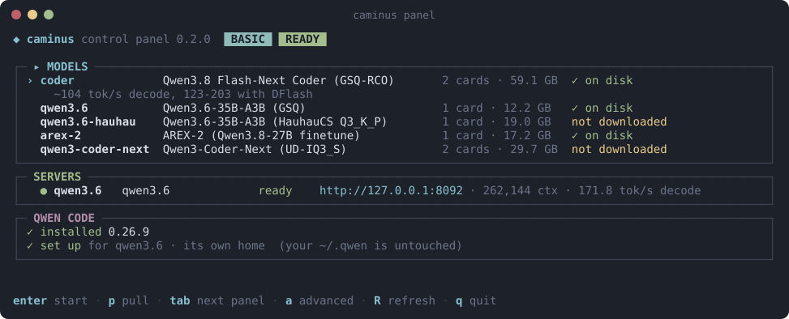

<p align="center">
  
</p>

<p align="center">
  <a href="https://pypi.org/project/caminus/"></a>
  <a href="https://github.com/jdominick05/caminus/releases/latest"></a>
  <a href="https://github.com/jdominick05/caminus/releases"></a>
  <a href="docs/verifying.md"></a>
  
  <a href="docs/hardware.md"></a>
  
  <a href="LICENSE"></a>
</p>

<p align="center">
  <b>Fast local coding models on your AMD Radeon RX 7900 cards.</b><br>
  Caminus is an inference engine written from the GPU kernels up for Radeon RDNA3 cards. It serves coding models to tools
  like Qwen Code through OpenAI- and Anthropic-compatible APIs. On the same cards it writes 1.1 to 2.4 times as fast as
  llama.cpp at short context.
</p>

> [!WARNING]
> **Caminus is early testing software, and things will break.** It has been tested on exactly one machine: an RX 7900 XTX
> and an RX 7900 XT on Linux. It runs Qwen models only, for now. If something goes wrong, please
> [open an issue](https://github.com/jdominick05/caminus/issues/new/choose) and paste the output of `caminus doctor`.
> Every report helps.

<p align="center">
  
</p>

## Get started

You need Linux, Python 3.12 and at least one RX 7900 XTX or XT.

```bash
pip install torch --index-url https://download.pytorch.org/whl/rocm7.2   # PyTorch for AMD cards
pip install caminus
caminus panel
```

In the panel you download a model, start it, and open Qwen Code on it. The [quickstart](docs/quickstart.md) walks you
through it in about ten minutes, plus the download.

**Nightly builds.** When the `testing` branch changes, it is built overnight and published as a
[pre-release](https://github.com/jdominick05/caminus/releases) (the newest one is at the top). It has what the next
release will have, tested less. To try one, install the wheel attached to it, for example
`pip install https://github.com/jdominick05/caminus/releases/download/v0.2.2.dev20261111/caminus-0.2.2.dev20261111-py3-none-any.whl`,
and please report what breaks.

## Supported hardware

| Card | Status |
|---|---|
| RX 7900 XTX (24 GB) | Supported and tested |
| RX 7900 XT (20 GB) | Supported and tested |
| Other cards with the same chip (gfx1100): RX 7900 GRE, Radeon Pro W7900, W7800 | Untested: Caminus will try them |
| Every other GPU | Not supported yet |

One card runs the one-card models. Two cards run two models side by side, or a two-card model: the Qwen3.8 Coder on an
XTX + XT or two XTX, or Swift 1.5 and ThinkingCap across both cards. See [hardware](docs/hardware.md) for slots, memory and getting full speed.

**Got other AMD hardware?** Please try Caminus on it and
[send a hardware report](https://github.com/jdominick05/caminus/issues/new?template=hardware_report.yml), even when it
works. Reports decide which cards get supported next. [Feature requests](https://github.com/jdominick05/caminus/issues/new?template=feature_request.yml)
are welcome too.

## Models

> [!NOTE]
> **Qwen models only, for now.** Every model below is a Qwen model or a finetune of one (the Qwen3 and Qwen3.8 families), and the server speaks Qwen's chat template and tool-call format. Other model families (Llama,
> Gemma, Mistral, DeepSeek and others) won't load. This may change in the future.

| Model | Cards | Decode | llama.cpp, same cards |
|---|---|---|---|
| AREX-2 27B (17 GB) | 1 (24 GB) | 41 tok/s | 36 tok/s |
| Qwen3.8-Flash-Next Coder (59 GB, 262K context) | 2 (XTX + XT or XTX + XTX) | 104 tok/s; 123-203 with its drafter | 44 tok/s; 65-92 with the drafter |
| Qwen3-30B-A3B Q4_K_M (19 GB) | 1 (24 GB) | 248 tok/s | 148 tok/s |
| Swift 1.5 27B Q4_K_M (17 GB) | 1 (24 GB); or 2 | 42 tok/s; 64 on two cards | 37 tok/s; 44 on two cards (`-sm tensor`) |
| ThinkingCap 27B RCO 4.2 bpw (14 GB) | 1; or 2 | 47 tok/s; 68 on two cards | 40 tok/s; 46 on two cards (`-sm tensor`) |

**Paused for this release:** Qwen3.6-35B-A3B (both files) and Qwen3-Coder-Next. They aren't measured on the current
code, so `caminus pull`, `caminus start` and `caminus serve` refuse them for now; they come back once they are measured
again.

Decode is how fast a model writes, at short context. Prompt reading, context sizes and which model to pick:
[models](docs/models.md). Where every number comes from: [benchmarks](docs/dev/benchmarks.md).

Qwen3-30B-A3B runs on Caminus's own code at every step, from reading the GGUF file to the output token, with no
llama.cpp code on its path: [how, how fast and how accurate](docs/dev/qwen3-30b-a3b.md).

## Documentation

- **Use Caminus:** [quickstart](docs/quickstart.md) · [the panel](docs/panel.md) · [models](docs/models.md) ·
  [hardware](docs/hardware.md) · [harnesses](docs/harnesses.md) · [the advisor](docs/advisor.md) ·
  [troubleshooting](docs/troubleshooting.md) ·
  [without the panel](docs/cli.md) · [configuration](docs/configuration.md) · [verify your download](docs/verifying.md) ·
  [what changed](CHANGELOG.md)
- **Contribute:** [CONTRIBUTING.md](CONTRIBUTING.md) · [how it works](docs/dev/architecture.md) ·
  [building from source](docs/dev/building.md) · [testing](docs/dev/testing.md)
- **AI agents working on this code:** [AGENTS.md](AGENTS.md)

## License

Copyright (C) 2026 jdominick05. Caminus is licensed under the [GNU AGPL v3.0 or later](LICENSE). Third-party code and its
notices: [THIRD_PARTY.md](THIRD_PARTY.md).

Caminus doesn't include any model weights. Each model comes from its own repository under its own licence; read it before
you use the model ([models](docs/models.md#licences)).
