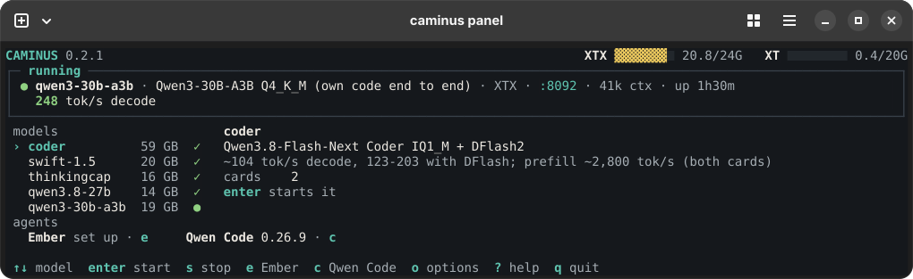
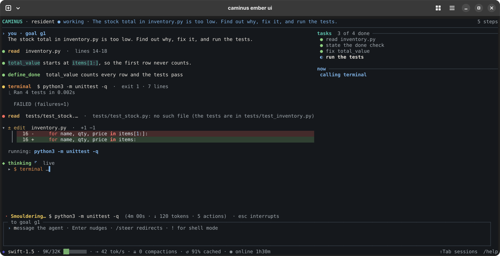

<p align="center">
  
</p>

<p align="center">
  <a href="https://pypi.org/project/caminus/"></a>
  <a href="https://github.com/jdominick05/caminus/releases/latest"></a>
  <a href="https://github.com/jdominick05/caminus/releases"></a>
  <a href="docs/verifying.md"></a>
  
  <a href="docs/hardware.md"></a>
  
  <a href="LICENSE"></a>
</p>

<p align="center">
  <b>Fast local coding models on your AMD Radeon RX 7900 cards.</b><br>
  Caminus is an inference engine written from the GPU kernels up for Radeon RDNA3 cards; on the same cards it writes 1.1
  to 2.4 times as fast as llama.cpp at short context. It serves Qwen Code, and any OpenAI- or Anthropic-compatible tool,
  from your own machine.
</p>

> [!WARNING]
> **Caminus is early testing software, and things will break.** It has been tested on exactly one machine: an RX 7900 XTX
> and an RX 7900 XT on Linux. It runs Qwen models only, for now. If something goes wrong, please
> [open an issue](https://github.com/jdominick05/caminus/issues/new/choose) and paste the output of `caminus doctor`.
> Every report helps.

## Get started

You need Linux on x86-64, Python 3.12 and at least one RX 7900 XTX or XT (plus Docker to build from source). Two steps:
install Caminus, then let the wizard set up the rest.

### 1. Install

**Build it from source (recommended).** The build runs the release recipe inside the public build image: on the CPU, no
GPU needed, nothing installed on your system besides Docker. Built from a release tag, the wheel is byte for byte the
published one. Build the tag of the latest release:

```bash
git clone https://github.com/jdominick05/caminus.git && cd caminus
git checkout "$(git tag -l 'v*' --sort=-v:refname | grep -v dev | head -n1)"   # the latest release's tag (not a nightly's)
tools/release/in_image.sh tools/release/release_build.sh    # GPU code + wheel into dist/ (--untagged at any other commit)
python3.12 -m venv ~/caminus-venv && source ~/caminus-venv/bin/activate
pip install torch --index-url https://download.pytorch.org/whl/rocm7.2   # PyTorch for AMD cards (not on PyPI)
pip install dist/caminus-*.whl
```

The build needs Docker that your user can run (`docker run hello-world` works). It refuses a checkout with an old
`dist/`: build from a fresh clone. 0.2.1 and older predate the build image: build those with
[their own building notes](https://github.com/jdominick05/caminus/blob/v0.2.1/docs/dev/building.md).

**Or install the prebuilt package.** It holds the same files: every release is built with the same recipe and signed,
and its provenance can be checked against the source ([verifying a download](docs/verifying.md); self-assessed against SLSA
Build L3).

```bash
python3.12 -m venv ~/caminus-venv && source ~/caminus-venv/bin/activate
pip install torch --index-url https://download.pytorch.org/whl/rocm7.2   # PyTorch for AMD cards (not on PyPI)
pip install caminus
```

**Nightly builds.** When the `testing` branch changes, it is built overnight and published as a
[pre-release](https://github.com/jdominick05/caminus/releases) (the newest one is at the top). It has what the next
release will have, tested less. Nightlies are on GitHub only for now, not on PyPI. To try one, copy the link of the `.whl`
file attached to the newest pre-release and install it:
`pip install https://github.com/jdominick05/caminus/releases/download/vX.Y.Z.devYYYYMMDD/caminus-X.Y.Z.devYYYYMMDD-py3-none-manylinux_2_17_x86_64.whl`.
Please report what breaks.

### 2. Run the wizard

```bash
caminus wizard
```

It checks your machine, downloads and starts the model for your cards, and sets up Qwen Code, printing each command
before it runs it (`caminus wizard --dry-run` shows the plan first). [The quickstart](docs/quickstart.md) walks through
the wizard and the same steps in the panel (`caminus panel`).

<p align="center">
  
</p>

### The model for your setup

| Your cards | What runs | Start with |
|---|---|---|
| One XT | ThinkingCap, the plain Qwen3.8 27B | ThinkingCap |
| One XTX | Those two, plus Qwen3-30B-A3B and Swift 1.5 | Swift 1.5 |
| XTX + XT | Everything, including the Coder and the two-card forms | the Coder (both cards) |
| Two XTX | The same as XTX + XT. Untested: reports are welcome. | the Coder (both cards) |
| Two XT | Two-card Swift 1.5, ThinkingCap or Qwen3-30B-A3B, or two one-card models side by side; no Coder. Untested: reports are welcome. | ThinkingCap |

The wizard preselects the model in the last column. Qwen3-30B-A3B is the fastest writer on one 24 GB card, but it
finishes fewer agent tasks for now. Every model, its speed and its context: [models](docs/models.md).

## Supported hardware

Supported and tested: RX 7900 XTX (24 GB) and RX 7900 XT (20 GB). Other gfx1100 cards (RX 7900 GRE, Radeon Pro W7900,
W7800) are untested; Caminus will try them. Every other GPU is not supported yet. One card runs the one-card models; the
Coder needs two. Which cards, slots and models work together: [hardware](docs/hardware.md).

**Got other AMD hardware?** Please try Caminus on it and
[send a hardware report](https://github.com/jdominick05/caminus/issues/new?template=hardware_report.yml), even when it
works. Reports decide which cards get supported next. [Feature requests](https://github.com/jdominick05/caminus/issues/new?template=feature_request.yml)
are welcome too.

## Models

> [!NOTE]
> **Qwen models only, for now.** Every model below is a Qwen model or a finetune of one (the Qwen3 and Qwen3.8 families), and the server speaks Qwen's chat template and tool-call format. Other model families (Llama,
> Gemma, Mistral, DeepSeek and others) won't load. This may change in the future.

| Model | Cards | Decode | llama.cpp, same cards |
|---|---|---|---|
| Qwen3.8-Flash-Next Coder (59 GB, 262K context) | 2 (XTX + XT or XTX + XTX) | 104 tok/s; 123-203 with its drafter | 44 tok/s; 65-92 with the drafter |
| Qwen3-30B-A3B Q4_K_M (19 GB) | 1 (24 GB); or 2 | 248 tok/s; served, 213 on two cards against 245 on one (two cards are faster from about 32K) | 148 tok/s; 112 on two cards (`-sm tensor`) |
| Swift 1.5 27B Q4_K_M (19.5 GB) | 1 (24 GB); or 2 | 42 tok/s; 64 on two cards | 37 tok/s; 44 on two cards (`-sm tensor`) |
| ThinkingCap 27B RCO 4.2 bpw (16.4 GB) | 1; or 2 | 47 tok/s; 69 on two cards | 40 tok/s; 46 on two cards (`-sm tensor`) |
| Qwen3.8-27B GSQ-RCO IQ3_S (14.2 GB) | 1 | 55 tok/s | not measured yet |

**Paused for this release:** Qwen3.6-35B-A3B, Qwen3-Coder-Next and AREX-2 ([models](docs/models.md#the-models)).

Decode is how fast a model writes, at short context. Prompt reading, context sizes and which model to pick:
[models](docs/models.md). Where every number comes from: [benchmarks](docs/dev/benchmarks.md).

Qwen3-30B-A3B runs on Caminus's own code at every step, from reading the GGUF file to the output token, with no
llama.cpp code on its path: [how, how fast and how accurate](docs/dev/qwen3-30b-a3b.md).

## Experiments

Early work that ships in the package but is not the recommended setup yet. Expect rough edges.

### Ember

<p align="center">
  
</p>

Ember (`caminus ember`) gives an AI agent its own account on your machine: you give it goals and steer it while it
works, on a local model or a paid API. It is early and tested on one machine, and its setup assumes Debian or Ubuntu
with systemd: read [its known limits](docs/ember.md#known-limits) before you set it up.

The [Ember quickstart](docs/ember-quickstart.md) walks through the setup and [the guide](docs/ember.md) explains how it works.
After you upgrade Caminus (`pip install -U caminus`), run `caminus ember agent install` again: a running agent takes the
new runtime between goals ([every command](docs/resident-agent.md)).

## Documentation

- **Use Caminus:** [quickstart](docs/quickstart.md) · [the panel](docs/panel.md) · [models](docs/models.md) ·
  [hardware](docs/hardware.md) · [harnesses](docs/harnesses.md) · [the advisor](docs/advisor.md) ·
  [troubleshooting](docs/troubleshooting.md) ·
  [without the panel](docs/cli.md) · [configuration](docs/configuration.md) · [verify your download](docs/verifying.md) ·
  [what changed](CHANGELOG.md)
- **Experiments: Ember, the agent environment (`caminus ember`):** [known limits](docs/ember.md#known-limits) ·
  [quickstart](docs/ember-quickstart.md) · [the guide](docs/ember.md) · [every command and view](docs/resident-agent.md)
- **Contribute:** [CONTRIBUTING.md](CONTRIBUTING.md) · [how it works](docs/dev/architecture.md) ·
  [building from source](docs/dev/building.md) · [testing](docs/dev/testing.md)
- **AI agents working on this code:** [AGENTS.md](AGENTS.md)

## License

Copyright (C) 2026 jdominick05. Caminus is licensed under the [GNU AGPL v3.0 or later](LICENSE). Third-party code and its
notices: [THIRD_PARTY.md](THIRD_PARTY.md).

Caminus doesn't include any model weights. Each model comes from its own repository under its own licence; read it before
you use the model ([models](docs/models.md#licences)).
