<p align="center">
  
</p>

<p align="center">
  <a href="https://pypi.org/project/caminus/"></a>
  <a href="https://github.com/jdominick05/caminus/releases/latest"></a>
  <a href="https://github.com/jdominick05/caminus/releases"></a>
  <a href="docs/verifying.md"></a>
  
  <a href="docs/hardware.md"></a>
  
  <a href="LICENSE"></a>
</p>

<p align="center">
  <b>Fast local models on your AMD Radeon RX 7900 cards, and an AI agent that works with them.</b><br>
  Caminus is an inference engine written from the GPU kernels up for Radeon RDNA3 cards; on the same cards it writes 1.1
  to 2.4 times as fast as llama.cpp at short context. Ember, its agent environment, gives an AI agent its own account on
  your machine: you give it goals and steer it while it works, on a local model or a paid API.
</p>

> [!WARNING]
> **Caminus is early testing software, and things will break.** It has been tested on exactly one machine: an RX 7900 XTX
> and an RX 7900 XT on Linux. It runs Qwen models only, for now. If something goes wrong, please
> [open an issue](https://github.com/jdominick05/caminus/issues/new/choose) and paste the output of `caminus doctor`.
> Every report helps.

<p align="center">
  
</p>

## Get started

You need Linux, Python 3.12 and at least one RX 7900 XTX or XT (plus Docker to build from source). Four steps: install,
open the panel, start the model for your cards, then set up Ember.

### 1. Install

**Build it from source (recommended).** The build runs the release recipe inside the public build image: on the CPU, no
GPU needed, nothing installed on your system besides Docker. Built from a release tag, the wheel is byte for byte the
published one. Releases build this way from 0.3.0 on; until 0.3.0 is out, build the development branch (`testing`):

```bash
git clone https://github.com/jdominick05/caminus.git && cd caminus
git checkout testing        # from 0.3.0 on: the tag of the "Latest" release instead (not a nightly pre-release)
tools/release/in_image.sh tools/release/release_build.sh --untagged    # GPU code + wheel into dist/ (drop --untagged on a release tag)
python3.12 -m venv ~/caminus-venv && source ~/caminus-venv/bin/activate
pip install torch --index-url https://download.pytorch.org/whl/rocm7.2   # PyTorch for AMD cards
pip install dist/caminus-*.whl
```

The build needs Docker that your user can run (`docker run hello-world` works). It refuses a checkout with an old
`dist/`: build from a fresh clone. 0.2.1 and older predate the build image: build those with
[their own building notes](https://github.com/jdominick05/caminus/blob/v0.2.1/docs/dev/building.md).

**Or install the prebuilt package.** `pip install caminus` (after the PyTorch line above) installs the same files: every
release is built with the same recipe and signed, and its provenance can be checked against the source
([verifying a download](docs/verifying.md); self-assessed against SLSA Build L3). Ember arrives on PyPI with 0.3.0; while
0.3.0 is a release candidate, install it with `pip install "caminus>=0.3.0rc1"` (a plain `pip install caminus` skips
release candidates and gets 0.2.1, without Ember).

### 2. Open the panel

```bash
caminus panel
```

The panel lists the models, downloads and starts them, shows your cards and running servers, and sets up the
harnesses. If anything looks wrong, `caminus doctor` checks the machine ([troubleshooting](docs/troubleshooting.md)).

<p align="center">
  
</p>

### 3. Start the model for your setup

| Your cards | What runs | Ember's default local model |
|---|---|---|
| One XT | ThinkingCap, the plain Qwen3.8 27B | ThinkingCap |
| One XTX | Those two, plus Qwen3-30B-A3B and Swift 1.5 | Swift 1.5 |
| XTX + XT | Everything, including the Coder and the two-card forms | the Coder (both cards) |
| Two XTX | The same as XTX + XT. Untested: reports are welcome. | the Coder (both cards) |
| Two XT | Two-card Swift 1.5, ThinkingCap or Qwen3-30B-A3B, or two one-card models side by side; no Coder. Untested: reports are welcome. | ThinkingCap |

Download and start it from the panel, or `caminus pull MODEL && caminus start MODEL`. Qwen3-30B-A3B is the fastest
writer on one 24 GB card but is not Ember's default yet: it finishes fewer agent tasks for now. Every model, its speed
and its context: [models](docs/models.md).

### 4. Set up Ember

```bash
caminus ember setup                               # writes the one root step and says how to run it
sudo sh ~/.local/share/caminus/env-setup.sh       # the agent's account, its group and the shared folders; safe to rerun
caminus ember setup                               # installs the agent's side; every line should say PASS
caminus ember agent install
caminus ember agent init resident --model MODEL_ID --endpoint http://127.0.0.1:8092/v1
caminus ember agent start resident
caminus ember ui
```

`caminus ember setup` names the default model for your cards at the end; `MODEL_ID` is what the running server reports.
Ember works the same on a paid API, through a key relay that holds your key and caps the day's spend. The
[Ember quickstart](docs/ember-quickstart.md) walks through all of it, and [the guide](docs/ember.md) explains how it works.

Prefer another harness? The panel sets up [Qwen Code](docs/harnesses.md) on the same server, and any OpenAI- or
Anthropic-compatible client can use it. The [quickstart](docs/quickstart.md) covers the panel and Qwen Code.

**Nightly builds.** When the `testing` branch changes, it is built overnight and published as a
[pre-release](https://github.com/jdominick05/caminus/releases) (the newest one is at the top). It has what the next
release will have, tested less. To try one, install the wheel attached to it, for example
`pip install https://github.com/jdominick05/caminus/releases/download/v0.2.2.dev20261111/caminus-0.2.2.dev20261111-py3-none-any.whl`,
and please report what breaks.

## Supported hardware

| Card | Status |
|---|---|
| RX 7900 XTX (24 GB) | Supported and tested |
| RX 7900 XT (20 GB) | Supported and tested |
| Other cards with the same chip (gfx1100): RX 7900 GRE, Radeon Pro W7900, W7800 | Untested: Caminus will try them |
| Every other GPU | Not supported yet |

One card runs the one-card models. Two cards run two models side by side, or a two-card model: the Qwen3.8 Coder on an
XTX + XT or two XTX, or Swift 1.5, ThinkingCap and (when you ask for it, one card being its default) Qwen3-30B-A3B
across both cards. See [hardware](docs/hardware.md) for slots, memory and getting full speed.

**Got other AMD hardware?** Please try Caminus on it and
[send a hardware report](https://github.com/jdominick05/caminus/issues/new?template=hardware_report.yml), even when it
works. Reports decide which cards get supported next. [Feature requests](https://github.com/jdominick05/caminus/issues/new?template=feature_request.yml)
are welcome too.

## Models

> [!NOTE]
> **Qwen models only, for now.** Every model below is a Qwen model or a finetune of one (the Qwen3 and Qwen3.8 families), and the server speaks Qwen's chat template and tool-call format. Other model families (Llama,
> Gemma, Mistral, DeepSeek and others) won't load. This may change in the future.

| Model | Cards | Decode | llama.cpp, same cards |
|---|---|---|---|
| Qwen3.8-Flash-Next Coder (59 GB, 262K context) | 2 (XTX + XT or XTX + XTX) | 104 tok/s; 123-203 with its drafter | 44 tok/s; 65-92 with the drafter |
| Qwen3-30B-A3B Q4_K_M (19 GB) | 1 (24 GB); or 2 | 248 tok/s; served, 206 on two cards against 240 on one (two cards are faster from about 32K) | 148 tok/s; 112 on two cards (`-sm tensor`) |
| Swift 1.5 27B Q4_K_M (17 GB) | 1 (24 GB); or 2 | 42 tok/s; 64 on two cards | 37 tok/s; 44 on two cards (`-sm tensor`) |
| ThinkingCap 27B RCO 4.2 bpw (14 GB) | 1; or 2 | 47 tok/s; 68 on two cards | 40 tok/s; 46 on two cards (`-sm tensor`) |
| Qwen3.8-27B GSQ-RCO IQ3_S (12 GB) | 1 | 55 tok/s | not measured yet |

**Paused for this release:** Qwen3.6-35B-A3B (both files), Qwen3-Coder-Next and AREX-2. They aren't measured on the current
code, so `caminus pull`, `caminus start` and `caminus serve` refuse them for now; they come back once they are measured
again.

Decode is how fast a model writes, at short context. Prompt reading, context sizes and which model to pick:
[models](docs/models.md). Where every number comes from: [benchmarks](docs/dev/benchmarks.md).

Qwen3-30B-A3B runs on Caminus's own code at every step, from reading the GGUF file to the output token, with no
llama.cpp code on its path: [how, how fast and how accurate](docs/dev/qwen3-30b-a3b.md).

## Documentation

- **Use Caminus:** [quickstart](docs/quickstart.md) · [the panel](docs/panel.md) · [models](docs/models.md) ·
  [hardware](docs/hardware.md) · [harnesses](docs/harnesses.md) · [the advisor](docs/advisor.md) ·
  [troubleshooting](docs/troubleshooting.md) ·
  [without the panel](docs/cli.md) · [configuration](docs/configuration.md) · [verify your download](docs/verifying.md) ·
  [what changed](CHANGELOG.md)
- **The agent environment (`caminus ember`):** [quickstart](docs/ember-quickstart.md) · [the guide](docs/ember.md) ·
  [every command and view](docs/resident-agent.md)
- **Contribute:** [CONTRIBUTING.md](CONTRIBUTING.md) · [how it works](docs/dev/architecture.md) ·
  [building from source](docs/dev/building.md) · [testing](docs/dev/testing.md)
- **AI agents working on this code:** [AGENTS.md](AGENTS.md)

## License

Copyright (C) 2026 jdominick05. Caminus is licensed under the [GNU AGPL v3.0 or later](LICENSE). Third-party code and its
notices: [THIRD_PARTY.md](THIRD_PARTY.md).

Caminus doesn't include any model weights. Each model comes from its own repository under its own licence; read it before
you use the model ([models](docs/models.md#licences)).
