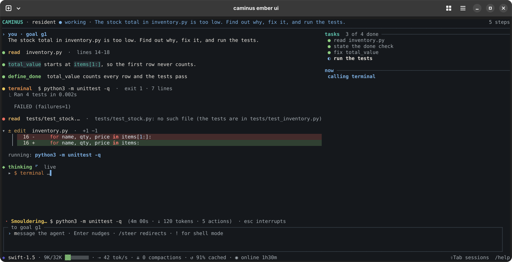

# Ember: the anti-harness

<p align="center">
  
</p>

Ember (`caminus ember`; `caminus env` still works) gives an AI agent a place to live on your machine: its own Unix account, its own files, its own
long-running loop. You give it goals and steer it as it works; when there is nothing to do, it has free time. New
here: [the quickstart](ember-quickstart.md). Every command and panel view: [the reference](resident-agent.md).

## What it is

Most coding agents are a harness around your terminal: they run in your session, as you, for as long as the window
is open, and each tool is something the harness hands them. `caminus ember` turns that around (hence anti-harness):

- **The agent is a resident, not a guest.** It runs as `caminus-agent`, a normal user with its own home, crontab,
  user services and installed tools. The terminal is the whole operating system, not a list of approved apps.
- **It keeps going.** A systemd user service runs its loop, so it outlives your terminal and your logout. Goals
  queue; long commands keep running between turns; an interrupted step is reported, not replayed blind.
- **You steer, it decides how.** A message reaches it at its next step; `/steer` redirects. It defines what done
  looks like before it changes anything, verifies against that, and a separate judge (a fresh model call that sees the
  evidence, not the agent's reasoning) checks the finish. The harness keeps its own record too: a verify needs
  something that looked after the last change, a refused edit blocks the finish until the change is made or the file
  is read, and the judge sees which files were actually changed.
- **Nothing waits on you.** Questions and root requests are cards you answer when you can. An unanswered question
  takes the agent's recommended option after 15 minutes; an unanswered permission or root request is a no.
- **It has free time.** With no goal, it reads its journal, follows its own interests, keeps projects in its studio,
  and leaves you things it thinks you will like (`/studio`). Free time is never graded and spends its own
  small allowance.
- **Any brain.** A local `caminus serve` model, or a paid API (Anthropic, DeepInfra) through a key relay you run.

Compared with Qwen Code and similar harnesses, the difference that matters most is what a harness cannot do: keep
working when you close the window. On speed and cost there is one small measurement so far: a single bug-fix task (a
buggy library, ten unit tests, the tests not to be edited), three alternating runs each, both harnesses on the same
model (DeepSeek-V4.1-Flash on DeepInfra) with the same relay and budget. All six runs passed; the medians were 16 s and
0.005 USD for the resident against 20 s and 0.006 USD for Qwen Code. That is too few runs on too small a task to call
either faster.

## The security model

- **A separate account, not a sandbox.** The agent has exactly the rights of a normal user named `caminus-agent`. It
  cannot read your home (mode 750 by default on Ubuntu) or other users' protected files, and it is not root. It can
  read anything world-readable, like any user can, and it can use the network. This keeps it out of your files by the
  ordinary Unix rules; it is not containment against a hostile program.
- **Root only with your approval.** The agent asks through `ask_root` with the exact command, the goal it unblocks,
  the expected effect and how to undo it. You approve, edit or deny it in the panel; approved commands run under your
  sudo, never the agent's. A grant (`g g`) lets that exact command repeat for the rest of its goal, at most 12 hours.
  An approved command runs without input (package tools ask nothing, no pager opens), and the chat comes back when it
  exits. After 30 minutes the chat comes back anyway, and the agent hears that the command is still running and its
  pid; nothing kills it.
- **You reach it; it does not reach you.** You log in to its account over SSH with your key, from this machine
  only, without forwarding. It has no way into your account.
- **Keys stay with you.** A paid brain goes through a relay: a service in your account that holds the API key, allows
  only priced models and stops at a daily dollar cap. The agent sees an endpoint, never the key.
- **The bridge.** `/srv/caminus-env-bridge` (root:caminus-env) is the only shared place: requests, answers, notes, GPU
  leases, and the emergency STOP file. The folder is sticky, so the agent cannot delete your STOP file.
- **The emergency stop.** `/halt` (or `caminus ember stop-all`) pauses every resident after its current step and ends
  the terminals it started; `/halt clear` lifts it.
- **GPUs.** The agent's account can use the GPUs (it is in `render` and `video`). Its prompt tells it to take a lease
  first and run GPU work under the repository's guard; nothing but the agent enforces that, so keep the GPU groups off
  its account (`sudo gpasswd -d caminus-agent render`) if you do not want it near them.
- **Everything is recorded.** Your audit log has every root request, answer, grant and panel control; its journal
  has every goal, tool call and result.

## Paid brains

A paid model is reached through a **key relay**: a small service in your own account that holds the API key, forwards
only the provider's chat endpoints, allows only priced models, and refuses requests once the day's dollar cap is spent
(HTTP 402; it resets at midnight). The agent is given the relay's local address, never the key.

| Provider | Key file (mode 600) | Relay address | Agent `--api` |
|---|---|---|---|
| Anthropic | `~/.config/anthropic/api_key` | `http://127.0.0.1:8765/v1` | `anthropic` |
| DeepInfra | `~/.config/caminus/deepinfra-key` | `http://127.0.0.1:8766/v1/openai` | `openai` (the default) |
| Mistral | `~/.config/caminus/mistral-key` (and its price file, `~/.config/caminus/mistral-prices.json`) | `http://127.0.0.1:8767/v1` | `openai` |

Anthropic, step by step (the others follow the same pattern; the quickstart shows DeepInfra):

```sh
mkdir -p ~/.config/anthropic
[ -e ~/.config/anthropic/api_key ] || install -m 600 /dev/null ~/.config/anthropic/api_key
$EDITOR ~/.config/anthropic/api_key                       # the key alone, on one line
caminus ember relay install --provider anthropic --cap-usd 3 --model claude-haiku-5-5
caminus ember agent install
caminus ember agent init resident --model claude-haiku-5-5 --api anthropic --endpoint http://127.0.0.1:8765/v1
caminus ember agent provider resident add anthropic --kind anthropic --endpoint http://127.0.0.1:8765/v1 --relay
```

- **Which models.** The Anthropic relay allows only the models named with `--model` (repeat it; Claude Haiku 5.5 when
  none is given). DeepInfra allows any chat model it publishes a price for. Mistral publishes no prices, so its relay
  allows only the models in your price file: JSON, USD per million tokens, for example
  `{"mistral-large-latest": [2.0, 6.0]}` as `[input, output]`, re-read when it changes; then
  `caminus ember relay install --provider mistral --cap-usd 3`.
- **Changing a relay.** `relay install` rewrites the service from the options you give it and restarts it (today's
  spend carries over), so give the whole set again: `--cap-usd` is required, and every `--model` you still want.
- **Several providers.** Install one relay per provider and add each with `agent provider NAME add`; `caminus ember
  agent models NAME --refresh` lists what each serves (context windows, output caps, prices), and `/model` in the chat
  (or `caminus ember agent model NAME ID`) switches between them at the next turn.
- **Spend.** `caminus ember relay status` shows each relay's spend today against its cap. The chat's status line shows
  the agent's own running cost.
- **The advisor.** An agent can ask a stronger model for advice (`caminus ember agent advisor NAME --model
  claude-opus-5-5 --endpoint http://127.0.0.1:8765/v1 --budget-usd 1`; it always speaks the Anthropic API). It goes
  through the same relay, so allow its model there too, with the cap restated:
  `caminus ember relay install --provider anthropic --cap-usd 3 --model claude-haiku-5-5 --model claude-opus-5-5`.
  Its own daily budget is counted by the agent, inside the relay's cap. `agent advisor` warns when the relay it names
  would refuse the model, and `caminus ember relay status` lists the models each Anthropic relay allows. When the
  advisor cannot be called (the relay refuses its model, is not running, or has spent its cap), `/advisor` opens the
  reason and the exact command to run, the agent's advisor tool says the same, and the attempt does not count against
  the goal's advisor calls. A running agent picks up an advisor you add or remove without a restart.
- **Removing one.** `caminus ember relay uninstall --provider anthropic` stops it; the key file stays where you put it.

## A second setup on one machine

The defaults (the `caminus-agent` account, the `caminus-env` group, the bridge in `/srv/caminus-env-bridge`) are one
setup per machine. A second person on the same machine, or a trial setup beside yours, needs its own of all three:
with a shared group, either side could write into the other's bridge. Set them in the second owner's shell (its
`~/.profile` keeps them) before the quickstart:

```sh
export CAMINUS_ENV_USER=ember-alex            # its agent account (created by the root script)
export CAMINUS_ENV_GROUP=ember-alex           # the group that owner and that agent share
export CAMINUS_ENV_BRIDGE=/srv/ember-alex-bridge
caminus ember setup                           # prints the root script for these names
```

`caminus ember agent init` passes that bridge to the agent. Each owner's SSH key (`~/.ssh/caminus_env_key`), audit
log and relays are in their own home already; relays listen on fixed local ports, so a second owner's relay takes
another one (`relay install ... --port 8775`, and the agent's `--endpoint` to match).

## Defaults

Every setting below works without being set. The resident's `config.json` lives in its home; a key in the table is a
key of that file.

| Setting | Default | What it does | Change it with |
|---|---|---|---|
| Compaction, local brain | at 85 % of the window, down to 20 % | old tool output is trimmed first; a summary only if needed | `compact_threshold`, `compact_target_ratio` |
| Compaction, paid brain | at 38 % of the window, down to 7.6 % | a paid brain resends its context every turn, so it compacts early | `paid_compact_threshold`, `paid_compact_target_ratio` |
| Free time | off | stretches of 30 min with 30 min rests; $0.50 a day on a priced model; 3 questions a day, each waiting 10 min; a dream pass from 03:00 | `caminus ember agent heartbeat NAME on`; `free_time.*` |
| Key relay | your key stays with you; `relay install` asks you to name a daily cap (`--cap-usd`); a relay run by hand defaults to $1 a day | the agent spends through it and never sees the key | `caminus ember relay install --provider P --cap-usd N` |
| Advisor | $1 a day, 5 calls per goal, effort medium | a stronger model the agent can consult | `caminus ember agent advisor NAME --budget-usd N --calls-per-goal N` |
| Fallback brain | takes over after 60 s down; $1 a day | a second brain while the first is unreachable | `caminus ember agent fallback NAME --budget-usd N --down-seconds N` |
| A request's wait | 15 min | a question then takes its recommended answer, a root request or permission is a no; in the prompt No is preselected for root and GitHub hand-offs | `question_timeout` (seconds) |
| Effort | the lab's recommendation for the model (below) | how hard the model thinks: none, low, medium, high, xhigh, max, each run as the model's nearest level | `/effort LEVEL`, `/effort default` |
| Generation | per model: the lab's settings (below) | sampling, the reply limit and thinking | `temperature`, `top_p`, `top_k`, `min_p`, `presence_penalty`, `max_tokens` |

Pick the effort level at the start of a chat: on the Qwen3.8 models a change re-reads the conversation once.

### Per model

| Model | Effort (default) | Sampling | One reply at most |
|---|---|---|---|
| Qwen3.8 line on Caminus (the Coder, Swift 1.5, ThinkingCap, Qwen3.8-27B) | xhigh; low, medium and xhigh are its levels (high and max run as xhigh, none turns thinking off) | the server's, from the model file (1.0 / top_p 0.95 / top_k 20) | 64K (the card allows 393K; capped so a runaway reply cannot hold the server) |
| Qwen3-30B-A3B on Caminus | thinking on (none turns it off; it has no other levels) | the server's | 32K (its card) |
| Anthropic | medium; low to max natively. none: thinking off at effort high on Haiku 5.5 and Opus 5, thinking only between tools on Sonnet 5.5; Opus 5.5, Fable and any other model always think, so none runs as low | none sent (the API refuses temperature, top_p and top_k) | the model's listed maximum, at most 64K |
| Mistral Large 4 | high; it has low, medium, high (none runs as low, xhigh and max as high) | 1.0 / top_p 0.95 | the listed maximum, at most 64K |
| Mistral Medium 3.5 | high; it has none and high (low runs as none, medium and above as high) | 0.7 / top_p 0.95 (top_p only at high) | the listed maximum, at most 64K |
| DeepSeek-V4.1-Flash | the provider's | 1.0 / top_p 1.0 | the listed maximum, at most 64K |
| Any other model | the provider's (or the server's) | the provider's (or the server's) | local: 64K; paid: the listed maximum up to 64K, else 4K |

A side call (the judge's check of a finish) always runs with thinking off.

## Where things live

| What | Where |
|---|---|
| The agent's account and home | `/home/caminus-agent` (`~/homes/NAME` per resident) |
| A resident's journal (goals, tool calls, events) | `~/homes/NAME/agent.sqlite3` in the agent's account |
| Its config, state, memory and notes | `~/homes/NAME/config.json`, `STATE.md`, `MEMORY.md`, `notes/` |
| Its free time | `~/homes/NAME/journal/`, `studio/` (with `studio/PROJECTS.md` and `studio/for-you/`, what it leaves you) |
| Its instructions | `~/ROBOTS.md` in the agent's account (refreshed by `caminus ember setup`) |
| Your key for its account | `~/.ssh/caminus_env_key` |
| Your audit log | `~/.local/state/caminus/env-audit.jsonl` |
| The setup script | `~/.local/share/caminus/env-setup.sh` |
| Relay keys | `~/.config/caminus/deepinfra-key`, `~/.config/anthropic/api_key` (mode 600) |
| Relay spend | `caminus ember relay status` |
| The bridge | `/srv/caminus-env-bridge` (`req/`, `res/`, `notes/`, `leases/`, `STOP`) |

## Its GitHub account

Give an agent its own GitHub account and a token file in its account (the token never leaves it), then link them
with `caminus ember agent github NAME link --token-file PATH --repo OWNER/NAME`.
Its terminals then use that account for `gh` and `git push`, and its commits carry its identity (the noreply email
GitHub links to the account, so a CLA check can find its signature). The token's text never appears in what it sees.

What its token may not do on your repositories (open a pull request from its fork, comment, approve a CI run from its
fork) asks where you type, like a root request: Yes runs it with your own `gh`, exactly as filed; No denies; "Tell it
something else" says what to do instead. Nothing it files is a command: the card holds checked fields, and the command is built from
them on your side.

Your files never move into the agent's account unless you put them there or approve a command that does.

## Troubleshooting

| Symptom | Cause and fix |
|---|---|
| `caminus ember setup` says the privileged step is still to do | Run `sudo sh ~/.local/share/caminus/env-setup.sh`, then `caminus ember setup` again. |
| `FAIL bridge` after the root script passed | Your account joined `caminus-env` but this session predates it: log out and in, or `newgrp caminus-env`. |
| `FAIL ssh login as the agent user` | The SSH server is not running or your key is not authorized: rerun the root script; it fixes both and says which. |
| `caminus ember ui: caminus-panel is not installed` | A source checkout: `cd panel && go build -o caminus-panel .` (the wheel ships it). |
| The agent stopped (`stopped` in the header) | `/start` in the panel, or `caminus ember agent start NAME`. The service restarts by itself after any exit except `/stop`. |
| A goal is `paused` | Its reason is on the goal (`/goals`): the watchdog (no progress, a token budget, the same call failing three times or repeated seven times), three plain replies, or three cut-off replies. Steer it, then `/resume`. |
| HTTP 402 from the relay | The day's cap is spent: it resets at midnight, or raise it with `relay install --cap-usd N`. |
| HTTP 403 "no published price" | The model is not on the provider's price list (or a stale model name in the config): pick one with `/model`. |
| Ember's box says there are no thoughts | The model answers without reasoning on this provider: `/effort` turns it on, at a token cost. |
| GNOME asks for an admin password | You opened a file in the agent's home from the file manager (an `admin://` path). Read its files with `caminus ember run` or from the panel instead. |
| Too many desktop notifications | `CAMINUS_PANEL_NOTIFY=0 caminus ember ui`. |

Still stuck: `caminus ember status` (each line PASS / FAIL with a fix), `caminus ember agent status NAME --json`, and the
agent's own log: `caminus ember run -s 'journalctl --user -u caminus-agent-NAME -n 50'`.
