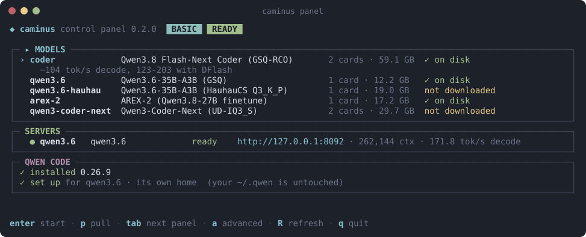

# The panel

By the end of this page you'll know every part of the Caminus panel and its keys. The panel is a terminal UI. It's the
easiest way to download models, start and stop them, and run Qwen Code on them.

```bash
caminus panel            # the basic layout
caminus panel -advanced  # every server option, the card choice, the brain / hands team
```



## The parts

| Part | What it shows |
|---|---|
| **MODELS** | Every model Caminus knows, how many cards it needs, its size, and whether it's on disk. |
| **SERVERS** | The models you started: their address, context size and current speed. |
| **QWEN CODE** | Whether Qwen Code is installed and set up for your server. Caminus keeps its own Qwen Code settings, so yours in `~/.qwen` stay untouched. |
| **OPTIONS** | Advanced layout only: every option of the server, for the next start. |
| **HARDWARE** | Shows up only when something is wrong with your cards, for example a card in a slot that's too slow. |

`tab` moves between the parts. The keys at the bottom always belong to the part you're in.

## Keys

| Where | Key | What it does |
|---|---|---|
| MODELS | `enter` | Start the model. |
| | `p` | Download it. |
| | `c` | Advanced: choose the card (auto, or a card number). |
| | `b` | Advanced: start the brain / hands team (below). |
| SERVERS | `enter` | Open Qwen Code on this server. |
| | `x` | Stop it. |
| | `t` | Restart it. |
| | `l` | Show its log. |
| | `m` | Open the live monitor. |
| QWEN CODE | `enter` | Launch Qwen Code. |
| | `u` | Set it up for the running server. |
| | `i` | Install it (needs Node.js and npm). |
| OPTIONS | `enter` | Edit or toggle an option. |
| | `d` | Reset it to its default. |
| Anywhere | `a` | Switch between the basic and advanced layouts. |
| | `R` | Refresh. |
| | `q` | Quit. Running models keep running. |

The panel remembers your layout and option values in `~/.config/caminus/panel.json`.

## The live monitor

`m` in **SERVERS**, or `caminus top` in a terminal, opens a live view of a running server: its speed, how much of each
prompt came from the cache, each card's memory and power, and any errors.

## The brain / hands team

With two cards you can run two models together: AREX-2 plans on the 24 GB card (the brain) and Qwen3.6 does the work on
the other card (the hands). Press `b` in the advanced layout, or run `caminus start --team brain-hands`. Qwen Code then
uses the brain as its main model and hands tasks to Qwen3.6.
