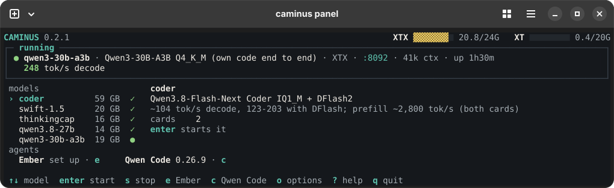

# The panel

By the end of this page you'll know every part of the Caminus panel and its keys. The panel is a terminal UI. It's the
easiest way to download models, start and stop them, and run Qwen Code on them.

```bash
caminus panel
```



## The screen

The panel is one screen, top to bottom:

| Part | What it shows |
|---|---|
| **Header** | `CAMINUS`, the version, and each card's memory in use. |
| **running** | The server in use: its model, cards, port, context and how long it has run, then its live speed (decode and prefill tokens per second), its Qwen Code clients and how much of the prompts came from the cache, with a line of its recent decode speed. A server started outside the panel (by a script, or `caminus serve` directly) shows too, marked "started outside the panel"; the panel watches it but never stops or restarts it. With nothing running the card says `no server running · enter starts the selected model`. |
| **models** | Every model Caminus knows, its download size and a mark: `●` running, `✓` on disk (yellow when its optional drafter is missing), `↓` not downloaded. Beside the list (below it in a narrow terminal), the selected model: what it is, how fast, its choices (cards, drafter, and for `qwen3-30b-a3b` the KV cache and the long-context mode), the context that fits your cards, any edited server options, and whether its last start failed. |
| **agents** | Ember (its sessions and how many work on a goal) and Qwen Code (its version, or what to do to set it up). |
| **Hardware** | Shows up under the header only when something is wrong with your cards, for example a card in a slot that's too slow. |

The last line lists the keys that do something right now.

## Keys

| Key | What it does |
|---|---|
| `↑` `↓` | Choose a model. |
| `tab` | Move to the selected model's next choice. |
| `←` `→` | Change that choice. The choice in brackets goes to the next start. |
| `enter` | Start the selected model. |
| `p` | Download it, or its missing DFlash drafter. |
| `s` | Stop the server in the running card (it asks first). |
| `t` | Restart it (it asks first). |
| `L` | Show its log. |
| `m` | Open the full monitor on it (`caminus top`, below). |
| `e` | Open Ember, the agent environment (`caminus ember ui`); before it is set up, the line says to run `caminus ember setup` ([Ember](ember.md)). |
| `c` | Open Qwen Code on the running server. |
| `u` | Set up Qwen Code for the running server. |
| `i` | Install Qwen Code (needs Node.js and npm). |
| `o` | The options editor: the card for one-card models, every option of the server, your cards and notes about them. |
| `n` `d` `v` `l` | Shortcuts for the choices: card count, drafter, KV cache, long context. |
| `R` | Refresh. |
| `?` | Every key. |
| `q` or `esc` | Quit. Running models keep running. |

`s`, `t`, `L`, `m` and `c` act on the server in the running card: the selected model's server when it runs, otherwise
the first one that's ready. Caminus keeps its own Qwen Code settings, so yours in `~/.qwen` stay untouched.

The choices: **cards** is one or two cards where the model supports both. **drafter** is auto (the server's measured
default for that model and card count), off, MTP or DFlash where supported at that card count. **KV cache**
(`qwen3-30b-a3b`): auto (F16; in the long-context mode the mode picks Q8 where only it holds the context), F16 or Q8
(half the memory per token: [models](models.md)). **context** (`qwen3-30b-a3b`): native, or long (YaRN x4: up to 131,072
tokens on two cards; on one card as far as it holds, measured 81,920 on an XTX with Q8, which the fit line shows for your
cards; short texts can read slightly differently, so it is off by default). Only the architecture's supported modes are
offered. If a model is on disk but its optional DFlash file is missing, `p` offers to download the drafter. Selecting
DFlash requires that file; off and the model's built-in MTP block can start without it.

In the options editor (`o`), `↑` `↓` choose, `enter` edits a value or switches an option on or off, `d` puts it back to
its default and `esc` goes back. Edited options go to every start and show on the main screen beside the model, so
nothing reaches the server out of sight. `--drafter` can point to a different file; the server validates that file when
it starts. The panel remembers the choices for each model and card count, along with the card and option values, in
`~/.config/caminus/panel.json`.

## The live monitor

`m` in the panel, or `caminus top` in a terminal, opens the full live view of a running server: its speed, how much of each
prompt came from the cache, each card's memory and power, and any errors. The panel's running card shows a few of these
numbers; the monitor has all of them.

### Agent-state lighting

The monitor can light your PC through OpenRGB. Start OpenRGB's **SDK Server**, then add this section to
`~/.config/caminus/top.json` (keep any other settings):

```json
{
  "openrgb": {
    "enabled": true,
    "host": "127.0.0.1:6742",
    "brightness": 0.65,
    "switch_modes": false,
    "fps": 20,
    "speed": 1,
    "fade_ms": 300
  }
}
```

`caminus top` and the panel's monitor inherit these preferences while choosing the selected server's address and agent
sessions. `LLMTOP_CONFIG` selects another preferences file. `caminus top -config FILE` uses a complete monitor config
directly. Your preferences file is left untouched.

By default, the monitor uses devices already in a per-LED mode, such as Direct. Set `switch_modes` to `true` if you want
it to temporarily select a supported Direct, Custom or Static mode. On a normal exit it restores the colors and full
mode settings that OpenRGB reported when it first connected. A lost connection or changed device layout can require
reapplying your OpenRGB profile.

`devices` limits the lights to matching device names, for example `["MYSTIC", "Vengeance"]`; leaving it empty includes
every usable device. The monitor never changes your zone sizes or saves a profile. Pause other lighting effects while
using it. The RGB status appears in **AGENTS**. Preview frames (`-once`) and the headless web view leave lighting alone.

The effects follow what the agent is doing:

| State | Lights |
|---|---|
| Server offline | Dim red. |
| Loading | Orange orbiting lights. |
| Idle or quiet | Steady dim cyan. |
| Between steps | Steady blue. |
| Waiting for you | A slow turquoise breath. |
| Reading a prompt | An amber sweep. |
| Writing tokens | A green comet. |
| Running a tool | Warm orange with a moving highlight. |
| Compacting context | Two orange-red lights that meet and separate. |

Colors fade between states instead of jumping. `fade_ms` sets the fade length (0–2000 ms; 0 disables it), `speed` sets
the animation rate (0.1–4), and `fps` sets the update rate (1–60). The defaults are 300 ms, 1×, and 20 FPS. Try 10 FPS for
sluggish RAM or GPU lighting. Steady frames are sent only when they change.

Eight-LED motherboard zones named **JARGB 2 / JARGB 3** (including **JARGB_V2_2 / JARGB_V2_3**) get circular effects in
opposite directions. RAM and GPU zones stay linear. The monitor uses the LED counts you configured in OpenRGB.
To choose a layout for another zone, add `zones` inside `openrgb`:

```json
"zones": {
  "Pump ring": "ring",
  "Rear fan": "reverse-ring",
  "JARGB 2": "strip"
}
```

The names match OpenRGB's zone names, ignoring case. `strip` disables circular effects for that zone. To change a state
color, add `colors`, for example `"colors": {"writing": "#00ff80", "waiting": "#00b4dc"}`. The state names in the first
column above are `offline`, `loading`, `idle` / `quiet`, `between`, `waiting`, `reading`, `writing`, `tool`, and `compacting`.

## The brain / hands team

> [!NOTE]
> **Paused for this release**, with Qwen3.6 (its hands): `caminus start --team brain-hands` says so and starts
> nothing. It comes back with Qwen3.6, from the command line.

With two cards you can run two models together: AREX-2 plans on the 24 GB card (the brain) and Qwen3.6 does the work on
the other card (the hands). Run `caminus start --team brain-hands`. Qwen Code then
uses the brain as its main model and hands tasks to Qwen3.6.
